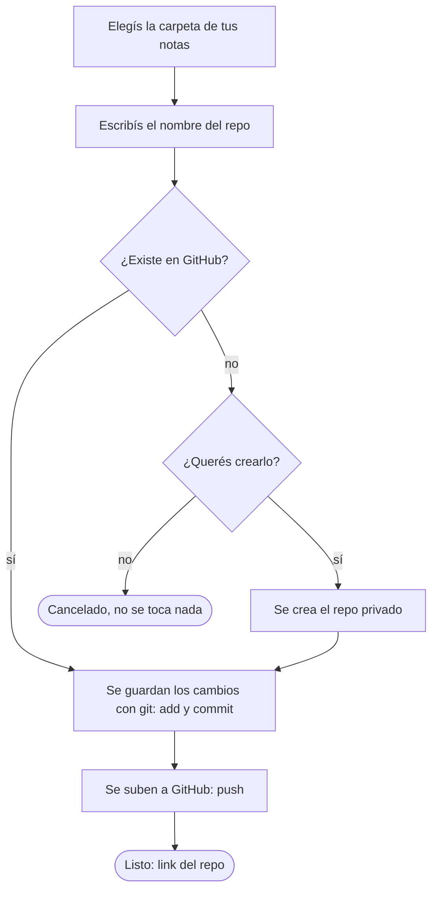

# backup-notas

Script de Python que guarda tus notas de Obsidian en un repo **privado** de GitHub.

Elegís la carpeta de tus notas, escribís el nombre del repo y el script hace el resto: si el repo no existe te pregunta si querés crearlo, y después sube todo con `git`.

## Requisitos

- Windows con Python 3.8 o superior
- [Git](https://git-scm.com/) (2.28 o superior)
- [GitHub CLI](https://cli.github.com/)

## Instalación

```
winget install GitHub.cli
gh auth login
gh auth setup-git
```

`gh auth login` inicia tu sesión de GitHub. `gh auth setup-git` hace que `git` use esa sesión al subir, así no te pide usuario y contraseña.

## Uso

```
python backup_notas.py
```

1. Se abre una ventana: elegí la carpeta de tus notas.
2. Escribí el nombre del repo.
3. Si no existe en tu cuenta, el script pregunta si queres crearlo con ese mismo nombre. Respondé `s` para crearlo (siempre privado) o `n` para cancelar sin tocar nada.
4. El script hace `git add`, `commit` y `push`, y al final muestra el link del repo.

Podés ejecutarlo todas las veces que quieras: si no hay cambios nuevos, solo te avisa.

## Diagrama



- Trabaja directo en tu carpeta de notas.
- Crea un `.gitignore` con `.obsidian/workspace*.json` (si no existe), porque ese archivo cambia constantemente y llena el historial.
- Cada commit se llama `auto: AAAA-MM-DD HH:MM`.
- La rama es `main`.
- Si la carpeta ya tenía un `origin`, lo apunta al repo que elegiste.

## Problemas frecuentes

| Problema | Solución |
|---|---|
| `Instalá GitHub CLI y corré 'gh auth login'` | Instalá `gh` y ejecutá `gh auth login`. |
| El push pide credenciales o se cuelga | Ejecutá `gh auth setup-git` una vez. |
| Error en `git commit` por `user.name` o `user.email` | `git config --global user.name "Tu Nombre"` y `git config --global user.email "tu@mail.com"` |
| El push se rechaza | El repo ya tiene commits que tu carpeta no tiene. Elegí un repo vacío o uno nuevo. |
| `No module named 'tkinter'` | Reinstalá Python marcando la opción *tcl/tk and IDLE*. |
| Dice que el repo no existe, pero sí existe | Revisá `gh auth status`. |

## Seguridad

- El repo se crea **siempre privado**.
- Igual, no guardes contraseñas, claves ni tokens dentro de tus notas: quedarían en el historial de Git.

## Limitaciones

- Es interactivo (abre una ventana y hace preguntas), así que no sirve para el Programador de tareas de Windows. (Probablemente lo haga después)
- Está pensado para un solo dispositivo que sube las notas.
- Un solo repo por ejecución.

## Estructura
```
backup-notas/
├── backup_notas.py   # todo el código 
└── README.md
```
