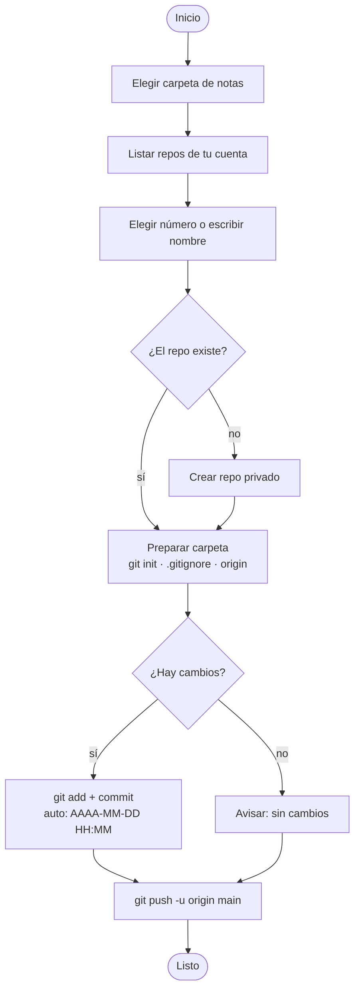

<div align="center">

# 📓 vaultNoteScript

**Notas de Obsidian en repo privado de GitHub.**


[Descarga](#descarga) · [Diagrama](#diagrama) · [Qué hace](#qué-hace) · [Problemas](#problemas) · [Limitaciones](#limitaciones)

</div>

---

## Resumen

Elegís la carpeta de tus notas, elegís (o creás) un repo, y el script hace `init`, `add`, `commit` y `push` por vos.
También puede **traer** tus notas desde un repo a otra máquina, preguntandote donde las queres guardar.

```text
=== Notas Unificadas ===
1. Subir notas
2. Traer notas
3. Salir
```

## Descarga

**Requisitos:** Python 3.8+ con *tkinter* · [Git](https://git-scm.com/) 2.28+ · [GitHub CLI](https://cli.github.com/)

### Windows

```powershell
winget install GitHub.cli
gh auth login
gh auth setup-git      # para que git use tu sesión y no pida contraseña

python backup_notas.py
```

### Linux

```bash
# Debian / Ubuntu
sudo apt install git gh python3-tk

# Fedora
sudo dnf install git gh python3-tkinter

# Arch
sudo pacman -S git github-cli tk

gh auth login
gh auth setup-git  

python3 backup_notas.py
```

> Necesita entorno gráfico: la selección de carpeta abre una ventana, así que no funciona sin display.

## Diagrama



### 1 · Subir notas

1. Se abre una ventana: elegí la carpeta de tus notas.
2. El script lista tus repos. Escribí el **número** de uno existente o un **nombre nuevo**.
3. Si el nombre no existe, se crea un repo **privado** con ese nombre.
4. Se hace `git add -A`, `commit` y `push`.

Podés ejecutarlo cuantas veces quieras: si no hay cambios nuevos, solo te avisa.

### 2 · Traer notas

Elegís un repo de la lista y se clona en la ruta seleccionada.

## Qué hace

| | |
|---|---|
| **Siempre privado** | Los repos nuevos se crean con `--private`. |
| **Trabaja en tu carpeta** | No copia nada a otro lado: inicializa git directamente en tu vault. |
| **`.gitignore` automático** | Ignora `.obsidian/workspace*.json`, que cambia todo el tiempo. |
| **Commits ordenados** | Cada commit se llama `auto: AAAA-MM-DD HH:MM`. |
| **Remote automático** | Si la carpeta ya tenía `origin`, lo apunta al repo elegido. |

## Problemas

<details>
<summary><b>Instalá GitHub CLI y corré 'gh auth login'</b></summary>

Instalá `gh` y ejecutá `gh auth login`. Verificá con `gh auth status`.
</details>

<details>
<summary><b>El push pide credenciales o se cuelga</b></summary>

Ejecutá `gh auth setup-git` una vez.
</details>

<details>
<summary><b>Error en <code>git commit</code> por <code>user.name</code> o <code>user.email</code></b></summary>

```bash
git config --global user.name "Tu Nombre"
git config --global user.email "tu@mail.com"
```
</details>

<details>
<summary><b>El push se rechaza</b></summary>

El repo ya tiene commits que tu carpeta no tiene. Elegí un repo vacío o creá uno nuevo.
</details>

<details>
<summary><b>No module named 'tkinter'</b></summary>

Reinstalá Python marcando la opción *tcl/tk and IDLE*.
</details>

<details>
<summary><b>Dice que el repo no existe, pero sí existe</b></summary>

Revisá `gh auth status`: puede que estés logueado con otra cuenta.
</details>

## Seguridad

- Los repos se crean **siempre privados**.
- De todas maneras no guardes contraseñas, claves ni tokens en tus notas: quedarían en el historial de Git aunque los borres después.

## Limitaciones

- Es interactivo (abre una ventana y hace preguntas), así que **no sirve todavía para el Programador de tareas** de Windows.

## Estructura

```text
vaultNoteScript/
├── backup_notas.py   # todo el código
└── README.md
```
